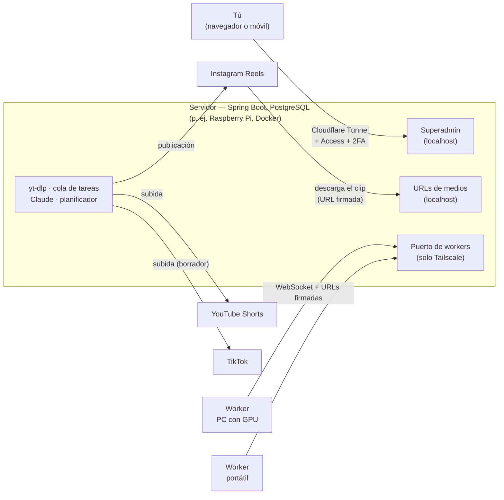

# ClipHive


> [Read in English](README.md)

**ClipHive convierte el enlace de un vídeo en clips verticales cortos con subtítulos karaoke palabra a palabra, y los publica de forma programada en TikTok, Instagram Reels y YouTube Shorts.** Es autoalojado y multiplataforma (Linux y Windows): un servidor pequeño —basta una Raspberry Pi— lo coordina todo, y uno o varios PC con GPU hacen la transcripción y el render.

## Por qué

Cortar vídeos largos (directos, pódcast, charlas, gameplay) en clips cortos y publicarlos con constancia en tres plataformas es un trabajo lento y repetitivo. El objetivo de ClipHive es hacerlo todo a partir de un solo enlace —descargar, transcribir, elegir los clips, renderizar, subtitular, escribir los títulos, programar, publicar y limpiar— sin editar nada a mano, y que tú sigas teniendo el control con pasos de revisión y confirmación donde los quieras.

## Funciones principales

- **Cualquier enlace que admita yt-dlp** — YouTube, Twitch, Kick y muchos más, con un motivo legible cuando un enlace no se puede usar (privado, bloqueo geográfico, directo en curso, DRM, demasiado largo…).
- **Clips que se entienden solos** — Claude lee la transcripción, quita intros, outros, patrocinios y tiempos muertos, y divide el contenido en secciones temáticas y clips que nunca cortan una frase por la mitad; las secciones largas salen como series numeradas ("Parte 2/3"). El servidor valida cada propuesta. O eliges tú los clips en el navegador (modo manual).
- **9:16 con fondo desenfocado y subtítulos karaoke** — grupos de 3–5 palabras con la que se está diciendo resaltada, un título en pantalla, 30/60 fps automático y codificación por GPU (AMD AMF, NVIDIA NVENC, VAAPI) con alternativa por CPU.
- **Título, descripción y hashtags por clip**, escritos por Claude, con crédito al creador original.
- **Publicación programada** en todas las cuentas conectadas a la vez, planificada cada día por Claude dentro de los límites de cada plataforma y con un ritmo según el tamaño de la cola, o inmediata, para pruebas. Listas de reproducción de YouTube por vídeo de origen.
- **Trabajo repartido y tolerante a fallos** — los workers entran y salen cuando quieren; una tarea de un equipo que desaparece vuelve a la cola, y el resultado tardío de un equipo dado por muerto se rechaza en vez de pisar el nuevo intento.
- **Una web superadmin** (funciona en el móvil) para enviar enlaces, revisar cortes, seguir tareas y workers, controlar las publicaciones, ver estadísticas y logs, y recibir avisos por email.
- **No deja rastro** — los vídeos y los clips se borran en cuanto se han publicado.
- **Seguro desde el diseño** — el superadmin detrás de Cloudflare Access más 2FA, los workers solo por Tailscale, URLs de ficheros firmadas y con caducidad, tokens OAuth cifrados en la base de datos y ningún secreto en el repositorio.

## Cómo funciona

1. Pegas un enlace en el superadmin.
2. El servidor lo valida y lo descarga con yt-dlp, y extrae el audio en trozos de unos 10 minutos.
3. Los workers transcriben los trozos con whisper.cpp (tiempos por palabra); Claude corrige las palabras mal reconocidas.
4. Claude propone los clips; el servidor los ajusta a pausas naturales y aplica los límites de duración. Si quieres, los revisas.
5. Claude escribe el título y la descripción de cada clip.
6. Los workers renderizan cada clip: recorte, 9:16 con fondo desenfocado, subtítulos karaoke y codificación por GPU.
7. El servidor programa y publica los clips en TikTok, Instagram y YouTube, recoge sus estadísticas y borra los ficheros.



La historia completa —componentes, el pipeline paso a paso, la tolerancia a fallos, el protocolo WebSocket, la publicación y la seguridad— está en [docs/ARCHITECTURE.md](docs/ARCHITECTURE.md) (en inglés) y, con todo el detalle y el porqué de cada decisión, en [docs/DESIGN.md](docs/DESIGN.md).

## Estructura del repositorio

```
ClipHive/
├── protocol/   mensajes WebSocket, DTOs y enums de estados compartidos (servidor + worker), sin lógica
├── server/     Spring Boot: cola, yt-dlp, Claude, planificador, publishers, superadmin (Thymeleaf + HTMX)
├── worker/     núcleo de transcripción y render, ventana JavaFX o modo headless
├── docs/       documento de diseño (fuente de verdad) y guías — índice en docs/README.md
├── .github/    CI, builds de whisper.cpp, instalador del worker, Dependabot
├── Dockerfile, docker-compose.yml   imagen del servidor
└── .env.example, CLAUDE.md, LICENSE, NOTICE, DISCLAIMER.md
```

## Puesta en marcha

1. **Despliega el servidor** en un equipo Linux de 64 bits (vale una Raspberry Pi 4/5), detrás de Cloudflare Tunnel, con la imagen Docker publicada (`ghcr.io/raulgl422/cliphive-server`) o con el jar de la página de [Releases](../../releases): [docs/DEPLOY.md](docs/DEPLOY.md).
2. **Instala un worker** en un PC con Windows y GPU con el MSI de la página de [Releases](../../releases): [docs/INSTALL-WORKER.md](docs/INSTALL-WORKER.md).
3. **Conecta tus cuentas y envía un enlace** desde el superadmin: [docs/USER-GUIDE.md](docs/USER-GUIDE.md).

Las guías están en inglés; la interfaz del superadmin y del worker está en español, y las guías citan sus textos tal cual.

¿Solo quieres echar un vistazo o tocar el código? Con el JDK 25 instalado, arranca el servidor en local con una base de datos embebida y desechable: `./mvnw install -DskipTests` una vez, después `./mvnw spring-boot:run -pl server -Pembedded -Dspring-boot.run.profiles=embedded` (o `.\run-server.ps1` en Windows), y entra en `http://localhost:8080/login` con `admin` / `admin123`. Más en [docs/DEVELOPMENT.md](docs/DEVELOPMENT.md).

## Requisitos

| | Necesita |
|---|---|
| **Servidor** | Linux de 64 bits (x86_64 o ARM64) o Windows, 4 GB de RAM o más y un SSD para el directorio de datos; Docker, o Java 25 + PostgreSQL 16+ + ffmpeg + yt-dlp + Deno + Claude Code |
| **Red** | Un dominio gestionado en Cloudflare (Tunnel + Access, vale el plan gratuito) y una red de [Tailscale](https://tailscale.com) que una el servidor y los workers |
| **Claude** | Claude Code es obligatorio en ambos casos: el servidor siempre llama a `claude -p`. Se autentica con una suscripción de Claude (`CLAUDE_CODE_OAUTH_TOKEN`) o con una API key de Anthropic (`ANTHROPIC_API_KEY`, que solo funciona a través de la CLI de Claude Code) |
| **Plataformas** | Una app de desarrollador en cada plataforma en la que publiques: proyecto de Google Cloud (YouTube), app de Meta con login de Instagram (Instagram, cuenta profesional) y app de desarrollador de TikTok |
| **Worker** | Windows 10/11 x64 con los drivers de la GPU y Tailscale; el MSI incluye Java, ffmpeg y whisper.cpp. También funciona sin GPU, más despacio |

## Estado

**Beta.** Todas las fases del plan están implementadas y funcionando de verdad: el servidor en Docker en una Raspberry Pi y el worker como MSI de Windows. Lo que falta está sobre todo fuera del código: hasta que **TikTok y Google auditen la app**, las subidas a TikTok llegan como borradores y las de YouTube como vídeos privados, así que publicarlos es un paso manual; solo Instagram es automático de punta a punta ([DESIGN.md §11.4](docs/DESIGN.md#114-consecuencias-de-no-estar-auditado-r3)). Las interfaces del superadmin y del worker están en español. Solo se publica el instalador del worker para Windows; los workers en Linux se ejecutan desde el código fuente.

## Hecho con IA

ClipHive se diseñó y escribió con una ayuda sustancial de IA —Claude, de Anthropic, usado a través de [Claude Code](https://claude.com/claude-code)— bajo la dirección y revisión de su autor. El autor fijó los objetivos y las decisiones de diseño, y revisó, probó y puso en marcha el resultado; buena parte del código y de la documentación la generó Claude en ese proceso. El [CLAUDE.md](CLAUDE.md) del proyecto y [docs/DESIGN.md](docs/DESIGN.md) son el contexto del que parten esas sesiones. Como con cualquier software, y más con el hecho con ayuda de IA, revísalo antes de confiar en él.

## Uso responsable

ClipHive descarga vídeos con yt-dlp y vuelve a publicar clips de ellos. **Úsalo solo con contenido que sea tuyo o que tengas permiso para usar**, y respetando las condiciones de todas las plataformas implicadas: resubir vídeos de otros puede infringir los derechos de autor, incumple las normas de las plataformas, y estas penalizan el contenido reciclado. Solo tú respondes de cómo lo usas: lee el [aviso legal](DISCLAIMER.md#aviso-legal).

## Contribuir y seguridad

Las contribuciones son bienvenidas, también las hechas con ayuda de IA si las has revisado: mira [CONTRIBUTING.md](CONTRIBUTING.md) y [docs/DEVELOPMENT.md](docs/DEVELOPMENT.md). ¿Has encontrado una vulnerabilidad? Infórmala en privado como explica [SECURITY.md](SECURITY.md); por favor, no abras una issue pública.

## Licencia

[Licencia Apache 2.0](LICENSE); ver también [NOTICE](NOTICE). El instalador del worker incluye componentes de terceros con sus propias licencias (build LGPL de FFmpeg, whisper.cpp, un runtime de Java y más), listados con sus fuentes en [THIRD-PARTY-NOTICES.txt](worker/packaging/licenses/THIRD-PARTY-NOTICES.txt).
