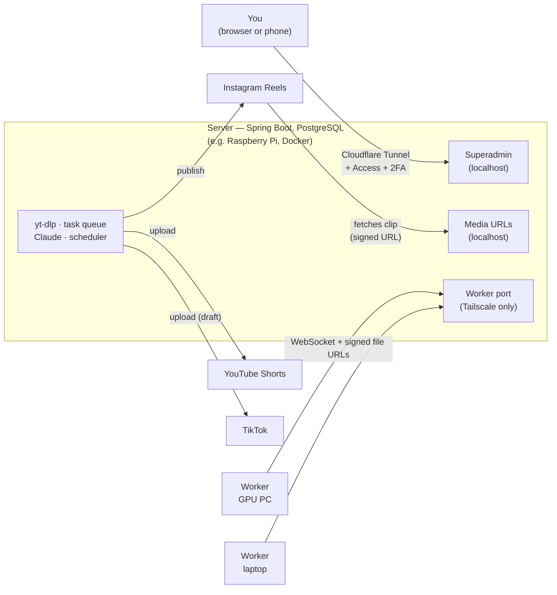

# ClipHive


> [Leer en español](README.es.md)

**ClipHive turns a video link into short vertical clips with word-by-word karaoke subtitles, and publishes them to TikTok, Instagram Reels and YouTube Shorts on a schedule.** It's self-hosted and cross-platform (Linux and Windows): a small server — a Raspberry Pi is enough — coordinates everything, and one or more PCs with a GPU do the transcription and rendering.

## Why

Cutting long videos (streams, podcasts, talks, gameplay) into short clips and posting them steadily on three platforms is slow, repetitive work. ClipHive's goal is to do all of it from a single pasted link — download, transcribe, choose the clips, render, caption, write the titles, schedule, publish and clean up — with no manual editing, while you keep control through review and confirmation steps where you want them.

## Key features

- **Any link yt-dlp supports** — YouTube, Twitch, Kick and many more, with a readable reason when a link can't be used (private, geo-blocked, live, DRM, too long…).
- **Clips that make sense on their own** — Claude reads the transcript, drops intros, outros, sponsors and dead air, and splits the content into thematic sections and clips that never cut a sentence in half; long sections become numbered series ("Part 2/3"). The server validates every proposal. Or choose the clips yourself in the browser (manual mode).
- **9:16 with a blurred background and karaoke subtitles** — groups of 3–5 words with the spoken word highlighted, an on-screen title, automatic 30/60 fps, GPU encoding (AMD AMF, NVIDIA NVENC, VAAPI) with a CPU fallback.
- **A title, description and hashtags per clip**, written by Claude, crediting the original creator.
- **Scheduled publishing** to all connected accounts at the same time, planned daily by Claude within each platform's limits and paced by the size of the queue — or immediately, for testing. YouTube playlists per source video.
- **Distributed, fault-tolerant work** — workers come and go freely; a task on a machine that disappears goes back to the queue, and a late result from a machine given up for dead is rejected instead of overwriting the new run.
- **A web superadmin** (works on a phone) to submit links, review cuts, follow tasks and workers, steer publications, see statistics and logs, and get email alerts.
- **Leaves no trace** — videos and clips are deleted as soon as they've been published.
- **Secure by design** — the superadmin behind Cloudflare Access plus 2FA, workers only over Tailscale, signed and expiring file URLs, OAuth tokens encrypted at rest, no secrets in the repository.

## How it works

1. You paste a link in the superadmin.
2. The server validates and downloads it with yt-dlp and extracts the audio in ~10-minute chunks.
3. Workers transcribe the chunks with whisper.cpp (word-level timestamps); Claude fixes misrecognised words.
4. Claude proposes the clips; the server snaps them to natural pauses and enforces the duration limits. Optionally, you review them.
5. Claude writes each clip's title and description.
6. Workers render each clip: cut, 9:16 with a blurred background, karaoke subtitles, GPU encoding.
7. The server schedules and publishes the clips to TikTok, Instagram and YouTube, collects their statistics, and deletes the files.



The full story — components, the pipeline step by step, fault tolerance, the WebSocket protocol, publishing and security — is in [docs/ARCHITECTURE.md](docs/ARCHITECTURE.md).

## Repository layout

```
ClipHive/
├── protocol/   shared WebSocket messages, DTOs and state enums (server + worker), no logic
├── server/     Spring Boot: queue, yt-dlp, Claude, scheduler, publishers, superadmin (Thymeleaf + HTMX)
├── worker/     transcription and rendering core, JavaFX window or headless mode
├── docs/       design document (Spanish, source of truth) and guides — index in docs/README.md
├── .github/    CI, whisper.cpp builds, worker installer, Dependabot
├── Dockerfile, docker-compose.yml   server image
└── .env.example, CLAUDE.md, LICENSE, NOTICE, DISCLAIMER.md
```

## Quick start

1. **Deploy the server** on a 64-bit Linux machine (a Raspberry Pi 4/5 works), behind Cloudflare Tunnel, with the published Docker image (`ghcr.io/raulgl422/cliphive-server`) or the jar from the [Releases](../../releases) page: [docs/DEPLOY.md](docs/DEPLOY.md).
2. **Install a worker** on a Windows PC with a GPU from the MSI on the [Releases](../../releases) page: [docs/INSTALL-WORKER.md](docs/INSTALL-WORKER.md).
3. **Connect your accounts and submit a link** in the superadmin: [docs/USER-GUIDE.md](docs/USER-GUIDE.md).

Just want to look around or hack on it? With JDK 25 installed, run the server locally with an embedded throwaway database: `./mvnw install -DskipTests` once, then `./mvnw spring-boot:run -pl server -Pembedded -Dspring-boot.run.profiles=embedded` (or `.\run-server.ps1` on Windows), and log in at `http://localhost:8080/login` with `admin` / `admin123`. See [docs/DEVELOPMENT.md](docs/DEVELOPMENT.md).

## Requirements

| | Needs |
|---|---|
| **Server** | 64-bit Linux (x86_64 or ARM64) or Windows, 4 GB RAM or more, an SSD for the data directory; Docker, or Java 25 + PostgreSQL 16+ + ffmpeg + yt-dlp + Deno + Claude Code |
| **Network** | A domain managed in Cloudflare (Tunnel + Access, free plan is fine) and a [Tailscale](https://tailscale.com) tailnet joining server and workers |
| **Claude** | Claude Code is required either way: the server always calls `claude -p`. Authenticate it with a Claude subscription (`CLAUDE_CODE_OAUTH_TOKEN`) or an Anthropic API key (`ANTHROPIC_API_KEY`, which only works through the Claude Code CLI) |
| **Platforms** | A developer app for each platform you publish to: Google Cloud project (YouTube), Meta app with Instagram login (Instagram, professional account), TikTok developer app |
| **Worker** | Windows 10/11 x64 with GPU drivers and Tailscale; the MSI bundles Java, ffmpeg and whisper.cpp. Works without a GPU too, slower |

## Status

**Beta.** Every phase of the plan is implemented and running for real: the server in Docker on a Raspberry Pi and the worker as a Windows MSI. What's still pending is mostly outside the code: until **TikTok and Google audit the app**, TikTok uploads arrive as drafts and YouTube uploads as private videos, so publishing them is a manual step; only Instagram is automatic end to end ([DESIGN.md §11.4](docs/DESIGN.md#114-consecuencias-de-no-estar-auditado-r3)). The superadmin and worker interfaces are in Spanish. Only the Windows worker installer is published; Linux workers run from source.

## Built with AI

ClipHive was designed and written with substantial help from AI — Anthropic's Claude, used through [Claude Code](https://claude.com/claude-code) — under the author's direction and review. The author set the goals and the design decisions, and reviewed, tested and ran the result; much of the code and documentation was generated by Claude in that process. The project's [CLAUDE.md](CLAUDE.md) and [docs/DESIGN.md](docs/DESIGN.md) are the context those sessions work from. As with any software, and especially AI-assisted software, review it before relying on it.

## Responsible use

ClipHive downloads videos with yt-dlp and republishes clips of them. **Use it only with content you own or are authorised to use**, and within the terms of every platform involved: reposting other people's videos can infringe copyright, breaks the platforms' rules, and platforms penalise recycled content. You alone are responsible for how you use it — read the [DISCLAIMER](DISCLAIMER.md).

## Contributing and security

Contributions are welcome, including AI-assisted ones you've reviewed: see [CONTRIBUTING.md](CONTRIBUTING.md) and [docs/DEVELOPMENT.md](docs/DEVELOPMENT.md). Found a vulnerability? Report it privately as described in [SECURITY.md](SECURITY.md) — please don't open a public issue.

## License

[Apache License 2.0](LICENSE) — see also [NOTICE](NOTICE). The worker installer bundles third-party components under their own licences (FFmpeg LGPL build, whisper.cpp, a Java runtime and more), listed with their sources in [THIRD-PARTY-NOTICES.txt](worker/packaging/licenses/THIRD-PARTY-NOTICES.txt).
