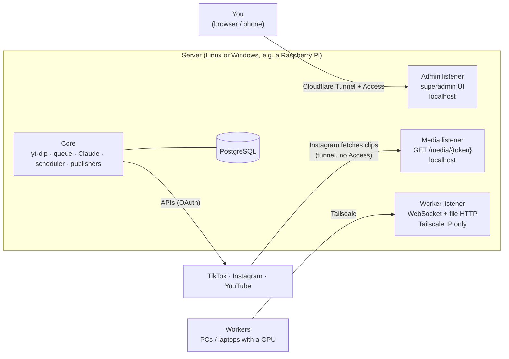

# ClipHive architecture

This is an English overview of how ClipHive is built. It summarises [`DESIGN.md`](DESIGN.md) (Spanish), which is the source of truth: every section below links to the DESIGN.md section with the full detail and the reasoning behind each decision. If the two ever disagree, DESIGN.md wins — please open an issue.

- [Components](#components)
- [Network: three listeners](#network-three-listeners)
- [The video pipeline](#the-video-pipeline)
- [State machines](#state-machines)
- [Tasks and fault tolerance](#tasks-and-fault-tolerance)
- [WebSocket protocol](#websocket-protocol)
- [Worker internals](#worker-internals)
- [Claude integration](#claude-integration)
- [Publishing](#publishing)
- [Security model](#security-model)
- [Data and retention](#data-and-retention)

---

## Components

| Module | What it does | What it never does |
|---|---|---|
| [`protocol/`](../protocol/README.md) | The contract between server and worker: the 13 WebSocket messages, their DTOs and the state enums. Plain Java + Jackson 3, no framework. | Business logic. If you're writing an `if` here, it belongs in `server` or `worker`. |
| [`server/`](../server/README.md) | Spring Boot 4 application: receives links, validates and downloads them with yt-dlp, extracts audio, keeps the task queue, talks to Claude, plans clips and publications, publishes to TikTok/Instagram/YouTube, serves files over signed URLs, collects statistics, cleans up, and hosts the superadmin web UI (Thymeleaf + HTMX; the statistics charts are hand-drawn SVG, no chart library). | Transcribe or render. There's no fallback: with no worker connected, jobs wait. |
| [`worker/`](../worker/README.md) | Plain Java program (JavaFX window + tray, or `--headless`) that connects to the server, transcribes audio chunks with whisper.cpp and renders clips with ffmpeg on the GPU. | See social accounts, OAuth tokens, global logs, statistics or anything else from the superadmin. |

The worker boundary is deliberate: a worker is any machine you lend to the system (a gaming PC, a laptop), so it only ever receives the files of its own task, through URLs that stop working when the task changes hands, and deletes them when it hands the task back ([DESIGN §3.1](DESIGN.md#31-componentes), [§8.1](DESIGN.md#81-qué-es)).

Pieces with more than one possible implementation are behind interfaces ([DESIGN §2.3](DESIGN.md#23-diseño-modular)): `Publisher` (TikTok, Instagram, YouTube, or a future intermediary), `LlmClient` (`claude -p`; an Anthropic API implementation exists but nothing selects it yet) and, in the worker, `Encoder` (AMF, NVENC, VAAPI, software).

## Network: three listeners

One Spring Boot application, three connectors ([DESIGN §3.2](DESIGN.md#32-red), [§13](DESIGN.md#13-seguridad)):

| Listener | Default bind | Reached through | Serves |
|---|---|---|---|
| **Admin** | `127.0.0.1:8080` (`CLIPHIVE_ADMIN_PORT`) | Cloudflare Tunnel **with** Cloudflare Access, e.g. `https://cliphive.example.com` | The superadmin, plus the public `/legal/privacy` and `/legal/terms` pages the platforms review |
| **Media** | `127.0.0.1:8081` (`CLIPHIVE_MEDIA_PORT`) | Cloudflare Tunnel **without** Access, e.g. `https://cliphive-media.example.com` | Only `GET /media/{token}`: one clip per signed URL, valid about an hour, so Instagram can fetch it |
| **Workers** | No default address: `CLIPHIVE_WORKER_BIND` (set it to the Tailscale IP), port 8082 (`CLIPHIVE_WORKER_PORT`). Left blank, the worker listener is not started and only a warning is logged | Tailscale only | The worker WebSocket (`/ws/worker`) and HTTP file transfer with signed URLs |

The media route exists because Instagram downloads the video from a public URL, and it can't get past Cloudflare Access nor reach a Tailscale address (*R1* in [DESIGN §22](DESIGN.md#22-revisión-técnica)). Both public hostnames are one-level subdomains because Cloudflare's free certificate covers `*.example.com` but not `*.cliphive.example.com`. A worker can't even reach the admin routes: they listen on a different interface.

## The video pipeline

Full table in [DESIGN §4](DESIGN.md#4-pipeline-completo-de-un-vídeo).

1. **Submit** (superadmin) — you paste a link and pick per-job options: language, fps mode, review mode, clip mode (automatic or manual) and audio (original or a dubbed track).
2. **Validate** (server) — `yt-dlp --dump-json --simulate` finds the platform, duration, fps, resolution, title, channel and category, and whether it can be downloaded. If not, or if it's longer than the maximum (2 h by default), the job is `REJECTED` with a readable reason (private, geo-blocked, live, DRM, unsupported site…).
3. **Download** (server) — yt-dlp, at most 1080p, after checking duration and free disk space. On YouTube, SponsorBlock segments are fetched as *data* (not cut out at download). With a dub selected and available, that audio track is downloaded.
4. **Extract audio** (server) — ffmpeg to 16 kHz mono WAV, split into ~10-minute chunks with a small overlap, so a long stream is many short tasks.
5. **TRANSCRIBE** (workers) — whisper.cpp with word-level timestamps, one task per chunk, in parallel. The server stitches the chunks, dropping the overlap, and asks Claude to fix misrecognised words without touching any timestamp ([§10.5](DESIGN.md#105-corrección-de-la-transcripción)).
6. **Analyse** (server, Claude) — Claude gets numbered segments and returns an editorial plan in *segment ids, never times*: where the useful content starts and ends, filler to remove (sponsors, greetings, dead air), thematic sections and the clips of each section, and the content type. The server validates it (order, overlaps, gaps, min/max duration). If Claude fails, a provisional cut by pauses is used and the job goes to review ([§10.2](DESIGN.md#102-análisis-de-contenido-paso-6)).
7. **Review** (superadmin, optional) — in review mode the job waits in `AWAITING_REVIEW` for your approval. You can edit the clips' titles and descriptions there; editing the cuts themselves isn't implemented yet.
8. **Plan clips** (server) — clip boundaries snapped to natural pauses, never mid-sentence; too-long clips are split into parts at sentence ends and too-short ones merged with a neighbour. Limits default to ~15 s – 3 min (YouTube Shorts' maximum).
9. **Metadata** (server, Claude) — a different title, description, hashtags and a short on-screen title for every clip, all clips of a video in one call so series ("Part 2/3") stay consistent. The server adds the part numbering itself.
10. **RENDER_CLIP** (workers) — the server cuts each clip's piece of the source with `ffmpeg -c copy` (fast, no re-encode, with a few seconds of margin); the worker downloads only that piece and does the exact cut, fps, 9:16 with a blurred background, karaoke subtitles and the GPU encode. One task per clip.
11. **Schedule** (server) — *immediate* mode (for testing) publishes as soon as a clip is rendered; *claude* mode lets a daily planner decide how many clips go out today and at what time ([§10.4](DESIGN.md#104-planificación-de-publicaciones-r2)).
12. **Publish** (server) — at the planned time, on every connected platform.
13. **Clean up** (server and workers) — files are deleted as soon as nothing needs them any more ([Data and retention](#data-and-retention)).
14. **Statistics** (server) — metrics of each publication and account are collected every 6 h during the first 7 days, then daily until day 90 ([§12.4](DESIGN.md#124-estadísticas)).

**Manual clip mode** ([§4.1](DESIGN.md#41-modo-manual-de-clips)): once the download finishes, the source video plays in the job page and you mark each clip's start and end while the worker transcribes the whole video. After you confirm the cuts there's no content analysis or review: each range is snapped to the nearest word boundary and becomes a clip. Claude still writes the titles and descriptions.

### Processing details

- **Transcription** ([§9.1](DESIGN.md#91-transcripción-whispercpp)): whisper.cpp full JSON output (`-ojf`) with per-word timestamps. With `whisperModel: auto` there are two tiers: `large-v3-turbo` if the whisper binary is a Vulkan or CUDA build, `base` if it's a CPU build. The backend is read from the binary's name, the installer's `whisper-cli.backend` marker or `whisper-cli --version`, not from the devices.
- **Render** ([§9.2](DESIGN.md#92-render-de-un-clip-ffmpeg)): `trim`/`atrim` (+ `concat` when filler was cut out of the middle), `fps`, then a `split` into a background (scaled down to 270×480, cropped, `gblur`, scaled up to 1080×1920) and a foreground scaled to 1080 wide, overlaid. Vertical sources are only scaled. Subtitles are an ASS file generated from the word timings, retimed to the clip, showing groups of 3–5 words (~25 characters, at most two lines) with the spoken word highlighted, 25 % of the height from the bottom by default. A fixed on-screen title sits near the top. AAC 160 kbps audio. A render that takes more than 30 minutes is killed and reported as failed.
- **Frame rate and bitrate** ([§9.4](DESIGN.md#94-fotogramas-por-segundo-y-bitrate)): `auto`, `30` or `60`. Today `auto` always renders at 30 fps: the planned 60 fps decision (metadata, Claude's content type, a motion measurement with `mpdecimate`) isn't implemented yet, so pick `60` on the job for 60 fps gameplay. About 8 Mbps at 30 fps and 12 Mbps at 60 fps.

## State machines

Defined once in `protocol` (`io.github.raulgl422.cliphive.protocol.state`) and stored as text in PostgreSQL ([DESIGN §5](DESIGN.md#5-estados)).

| Entity | States |
|---|---|
| Video job (`video_job`) | `SUBMITTED → VALIDATING → DOWNLOADING → TRANSCRIBING → ANALYZING → [AWAITING_REVIEW] / [AWAITING_SELECTION] → RENDERING → RENDERED → SCHEDULED → PUBLISHING → COMPLETED`, plus `REJECTED`, `FAILED`, `CANCELLED` |
| Clip (`clip`) | `PLANNED → RENDERING → RENDERED → SCHEDULED → PUBLISHED → CLEANED`, plus `FAILED`, `CANCELLED` |
| Task (`task`) | `PENDING → ASSIGNED → RUNNING → DONE`, back to `PENDING` on a lost worker, timeout or release; `FAILED` after too many failures; `CANCELLED` from the superadmin |
| Publication (`scheduled_post`, one per clip and platform) | `SCHEDULED → UPLOADING → PROCESSING → PUBLISHED`, or `FAILED` (retryable) / `CANCELLED` |

Final job states are never left: a validation or download that finishes after you cancelled doesn't revive the job. After a server restart, steps that only lived in memory (validation, download, chunking) start over; worker tasks are left alone because the worker keeps them across a reconnect ([§5.1](DESIGN.md#51-trabajo-de-vídeo-video_job)).

A publication uploaded as a TikTok draft or as a private YouTube video is `PUBLISHED` with an **awaiting confirmation** flag: it counts as out for the pacing of the queue, but the clip file is kept and the job isn't completed until you confirm it's really public ([§5.4](DESIGN.md#54-publicación-scheduled_post-una-por-clip-y-plataforma)).

## Tasks and fault tolerance

([DESIGN §6](DESIGN.md#6-cola-asignación-y-tolerancia-a-fallos))

- **Granularity**: one `TRANSCRIBE` per audio chunk, one `RENDER_CLIP` per clip. A lost worker loses one chunk or one clip, not the video.
- **Priority**: first clips of a video first; FIFO between jobs (changing a job's priority from the superadmin isn't implemented yet). `RENDER_CLIP` tasks are only handed out once their job is in `RENDERING` (so not before review approval). Tasks go to any worker with a free slot; there's no GPU preference for transcription yet.
- **Atomic assignment**: `SELECT … FOR UPDATE SKIP LOCKED` in PostgreSQL. Each worker declares how many tasks it accepts in parallel.
- **Attempt = fencing token**: every assignment carries an `attempt` number, and every worker message and file transfer about a task carries `taskId + attempt`. The server rejects anything with a stale attempt — that's what stops a worker that was given up for dead, and comes back late, from overwriting the new run. `attempt` goes up on every reassignment and on cancel. On the worker, each attempt runs in its own folder (`tasks/<taskId>-<attempt>`), and a new attempt of a task that's still running stops the old one.
- **Two counters per task** (*R9*): **failures** (`TASK_FAILED`, `TASK_REJECT` or a progress timeout) up to **3**, then `FAILED`; **disconnections** (lost heartbeat) up to **10** — closing a laptop lid isn't the task's fault. `TASK_RELEASE` counts in neither. A failed task can be retried from the job page (counters reset, attempt +1).
- **Heartbeat**: the server sends `PING` every 20 s and waits 10 s for `PONG`; 3 misses in a row and the session is dead and its tasks go back to `PENDING`. The worker watches too: no `PING` for `pingInterval × (maxMissedPings + 1)` and it reconnects, even if the socket looks open.
- **Progress timeout**: a task with no `TASK_ACCEPT`/`PROGRESS` for 30 minutes (setting *Tarea atascada sin progreso*) is considered stuck even if the worker answers pings: the server sends `TASK_CANCEL`, then requeues it as one failure. It's generous because a render sends no progress while ffmpeg encodes.
- **Voluntary stop**: stopping a worker cancels its tasks and sends `GOODBYE`, which ends the session without waiting for the heartbeat; the server puts its tasks back in the queue without spending an attempt. `TASK_RELEASE` gives one task back the same way; a paused worker uses it to answer every task it's offered (a paused worker still advertises its capacity, a known limitation: each release bumps the attempt).
- **Reconnects**: if a worker reconnects before the server noticed the old session died, its tasks stay assigned to it and it delivers them with the same attempt. Results that couldn't be sent (`TASK_DONE`, `TASK_FAILED`, `TASK_RELEASE`) are kept by the worker in memory and sent after the next `WELCOME`. That only helps if it reconnects in time: if the server already gave the task to someone else, the stored result carries an old attempt and is discarded; if the worker is closed first, it's lost and the progress timeout recovers the task.

## WebSocket protocol

The WebSocket only coordinates; files (audio chunks, video pieces, clips, transcripts) travel over HTTP on the worker port with signed, expiring URLs tied to `taskId + attempt` ([DESIGN §7](DESIGN.md#7-protocolo-websocket)). Messages are JSON with a `type` discriminator, implemented as a sealed hierarchy of Java records in `protocol` ([protocol/README.md](../protocol/README.md)).

| Direction | Message | Content |
|---|---|---|
| W → S | `HELLO` | Worker token, protocol and worker version, OS, capabilities (GPU, encoders, whisper backend, models, max parallel tasks) |
| S → W | `WELCOME` | Session id and settings (ping interval, timeouts) |
| S → W | `TASK_ASSIGN` | `taskId`, `attempt`, type (`TRANSCRIBE` / `RENDER_CLIP`), parameters, download and upload URLs |
| W → S | `TASK_ACCEPT` / `TASK_REJECT` | `taskId`, `attempt` (+ reason when rejecting) |
| W → S | `PROGRESS` | `taskId`, `attempt`, percentage, phase |
| W → S | `TASK_DONE` | `taskId`, `attempt`, references of the uploaded files |
| W → S | `TASK_FAILED` | `taskId`, `attempt`, error (with the tail of the tool's output) |
| W → S | `TASK_RELEASE` | `taskId`, `attempt`: give the task back (sent while paused) |
| S → W | `TASK_CANCEL` | `taskId` (cancelled from the superadmin, or stuck) |
| W → S | `GOODBYE` | Voluntary end of session |
| S ↔ W | `PING` / `PONG` | Heartbeat |

**Versioning** (*R14*): `HELLO` carries the protocol version; on a major mismatch the server refuses the connection and the worker tells you to update. A refused connection is closed with one of three English reasons, `Unknown token`, `Token revoked` or `Protocol version mismatch: update your worker`; the worker matches that text to explain what to do, so those strings are part of the contract. **Registration** (*R13*): a worker is created in the superadmin by name; its token is shown once and only its hash is stored; revoking it closes the worker's session.

## Worker internals

([DESIGN §8](DESIGN.md#8-worker), [§9.3](DESIGN.md#93-encoders-por-plataforma))

- **Two modes, one core**: a small JavaFX window with a tray icon (status, current task, phase, progress, recent log, *Pausar/Reanudar*, *Parar*, configuration editor), or `--headless` for services, where Ctrl+C / `SIGTERM` is a clean stop (cancel the running tasks + `GOODBYE`).
- **Configuration**: `worker.yml` in the OS data directory, overridden by `CLIPHIVE_WORKER_*` environment variables. A broken file stops the start with the file and key at fault instead of silently using defaults. Reference: [INSTALL-WORKER.md](INSTALL-WORKER.md#5-workeryml-reference).
- **Hardware detection**: ffmpeg's encoder list plus a short test encode with each GPU encoder, the whisper backend (from the binary, see [Processing details](#processing-details)) and the OS. The best encoder that passes the test is used; `forcedEncoder` can pin one. On Linux, VAAPI always uses `/dev/dri/renderD128`.

  | GPU / OS | Encoder |
  |---|---|
  | AMD / Windows | `h264_amf` |
  | AMD / Linux | `h264_vaapi` (different command: `hwupload` inside the filter graph) |
  | NVIDIA | `h264_nvenc` |
  | No usable GPU | `libopenh264` (the bundled ffmpeg is an LGPL build without `libx264`) |

  The startup test, the autotest and the real render all use the same `Encoder` (arguments and final filter), so what's tested is what renders.
- **Autotest**: on first start the worker transcribes and encodes a few seconds with that `Encoder`. With `forcedEncoder: auto`, a failing GPU encoder makes it test the software encoder; only if that passes is `software` saved in `worker.yml`. An encoder you forced that fails is left as you chose it, and the worker is *No puede aceptar tareas* (details in the log). If software fails as well, nothing is saved and the worker can't take tasks either. A failed or interrupted autotest isn't marked done and runs again on the next start.
- **Unusable worker**: missing ffmpeg or whisper-cli, or a failed autotest, and the worker still connects but advertises **0 parallel tasks**, so it gets nothing and no job burns its attempts; the window shows *No puede aceptar tareas* with the reason. Headless exits with code 2.
- **Models**: the whisper model is downloaded from Hugging Face on first use with its SHA-256 checked; a download stalled for 60 s is aborted, and an already-downloaded model is used instead if there is one.
- **Tools**: ffmpeg, ffprobe and whisper-cli are resolved from the configured path, then the installer's `bin/` folder next to the jar, then the `PATH`. All external processes run through `ProcessBuilder` with an argument list; their output is read separately, so time limits and cancellation work even if a tool hangs silently.
- **Local files**: only the task's own input (one audio chunk, or one clip's piece of video), deleted when the task is delivered.

## Claude integration

([DESIGN §10](DESIGN.md#10-análisis-y-metadatos-con-claude))

Claude is called through `LlmClient`, and today that's always `claude -p` (Claude Code in headless mode, run with no tools in an empty temporary folder). The CLI authenticates with `CLAUDE_CODE_OAUTH_TOKEN` or with `ANTHROPIC_API_KEY`. A direct Anthropic API client exists in the code but nothing selects it yet. Calls are retried with backoff; they aren't serialised, so several can run at once. Answers are always JSON with a fixed schema; the server validates them and retries when they don't comply. Claude is used for four things:

1. **Transcript correction** — same number of words per segment, timestamps untouched; never blocks (on failure the original transcript is used).
2. **Content analysis** — the editorial plan described in step 6. Coverage `completa` (default: every bit of content becomes a clip) or `destacados` (only the best sections, for long streams).
3. **Titles and descriptions** — title ≤ 100 characters, short description with 3–5 specific hashtags, credit to the original creator when known, no filler hashtags or clickbait; the same text on all three platforms. *Regenerar textos* on the job page asks again, giving Claude the full context of the video.
4. **Publication planner** — see below.

Claude proposes; the server guarantees: every answer is checked against hard rules (ids that exist, limits, order, platform caps) before it's used, and there's a deterministic fallback for each call.

## Publishing

([DESIGN §11](DESIGN.md#11-publicación-en-redes), [§10.4](DESIGN.md#104-planificación-de-publicaciones-r2))

| | TikTok | Instagram Reels | YouTube Shorts |
|---|---|---|---|
| API | Content Posting API, chunked `FILE_UPLOAD` | Graph API (Instagram login): `REELS` container → wait for `FINISHED` → `media_publish` | Data API v3 resumable `videos.insert` |
| Video source | Server uploads the file | Instagram fetches the signed media URL | Server uploads the file |
| Until the app is audited | Uploaded as a **draft** to your TikTok inbox; title and description are emailed to you to paste | Real publication (no review needed for your own account in development mode) | Uploaded as **private**; you make it public in YouTube Studio. Setting *YouTube: app auditada* switches to public uploads once Google approves |

So, until the TikTok and Google audits pass, **only Instagram is automatic end to end** ([§11.4](DESIGN.md#114-consecuencias-de-no-estar-auditado-r3)).

- **Planner** (`claude` mode): runs at 07:00 Europe/Madrid (or as soon as the server is up after that), and adds to the plan when 3 or more new clips are ready, or when you press *Replanificar*. Replanning only adds; it never moves what's already scheduled. Claude decides *how many* clips and *at what time*; *which* clips is fixed by the queue order (videos already started first, then the oldest; a video is finished before the next starts, parts in order). Each clip goes out **at the same time on every connected platform**, and a platform that falls behind holds the others back. The server enforces future times within today's window, daily caps (YouTube 10, TikTok 10, Instagram 25), a minimum gap per platform (90 min by default) and pacing (3 clips/day, up to 6 when the queue lasts more than 5 days). Fallback slots (`13:00,20:00`) when Claude fails.
- **Robustness**: the external id is saved as soon as the platform returns it, so a restart mid-upload checks the status instead of uploading twice; an upload interrupted before any id is marked failed rather than risking a duplicate. Platform limits postpone a publication by an hour without spending an attempt. A later part never starts before an earlier part of the same video on the same platform. Each platform uploads on its own thread.
- **Manual fallbacks**: when a platform refuses an upload because of its limit (TikTok's 5 pending drafts), you get one email with the text to paste and a download link, and can mark it *Ya lo subí a mano* (optionally with the link). Drafts and private uploads stay in *Falta publicar* until you press *Ya está publicado*; TikTok drafts can be re-sent. See the [user guide](USER-GUIDE.md#publications).
- **Playlists**: on YouTube, each source video gets a public playlist with its clips in order (setting *YouTube: lista por vídeo*).
- **Tokens**: OAuth tokens are refreshed automatically (Instagram's 60-day token a week before it expires; TikTok's 24 h token with its 1-year refresh token).

## Security model

([DESIGN §13](DESIGN.md#13-seguridad), [§12.1](DESIGN.md#121-tecnología-y-acceso))

- **No secrets in the repository**, including its history: everything secret or installation-specific is in `.env` (see [`.env.example`](../.env.example)); non-secret runtime settings live in the database `setting` table and are edited from *Ajustes*.
- **Superadmin**: listens on localhost only; reachable through Cloudflare Tunnel behind Cloudflare Access, then its own login with optional TOTP 2FA. One account, created on first boot from `CLIPHIVE_ADMIN_USER`/`_PASSWORD`, no registration endpoint. 5 wrong passwords lock that IP out for 15 minutes; 5 wrong TOTP codes lock the second step of that account for 15 minutes. A password-only session reaches the code form and nothing else. Session cookie `Secure` and `SameSite=Lax`.
- **Encryption at rest**: OAuth tokens and the TOTP secret are encrypted with AES-256-GCM using `CLIPHIVE_ENCRYPTION_KEY`. Lose that key and you have to reconnect every account and set up 2FA again.
- **Workers**: Tailscale-only port; a per-worker token (stored hashed) that only gives access to the WebSocket and the files of its own tasks; revocable.
- **Signed URLs**: worker file URLs are tied to `taskId + attempt`; media URLs cover one clip and expire in about an hour; both are HMAC-signed with `CLIPHIVE_URL_SIGNING_KEY`.
- **Input**: only `http(s)` links with a host are accepted, and yt-dlp receives them after `--`, so a link can never be read as an option.
- **Startup check**: before starting anything, the server validates its configuration and stops with the complete list of what's missing or malformed (database URL and user, an absolute data directory, a signing key of at least 32 characters, a Base64 encryption key of exactly 32 bytes). Missing public URLs or operator details only produce warnings ([§13.1](DESIGN.md#131-variables-de-entorno-del-servidor-envexample)).

## Data and retention

([DESIGN §14](DESIGN.md#14-persistencia), [§15](DESIGN.md#15-retención-de-ficheros-no-queda-rastro))

- **PostgreSQL** on the server, schema managed by Flyway (`server/src/main/resources/db/migration/`), validated by Hibernate. The table-by-table contract is in [DESIGN §14.2](DESIGN.md#142-esquema-detallado). Backups are optional: published clips stay on the platforms and the queue can be rebuilt by resubmitting links — but keep a copy of `.env` ([DEPLOY.md §16](DEPLOY.md#16-backups-and-keys)).
- **Data directory** (`CLIPHIVE_DATA_DIR`, ideally on an SSD): `jobs/<id>/source`, `audio`, `chunks`, `clips`.
- **"Leaves no trace"**: an hourly sweep (also on startup and on *Limpiar ahora*) deletes the source video and intermediates once the job finished rendering; each clip's files once none of its publications is pending (confirmed published or cancelled); the whole folder when the job ends; failed publications' files after `files.retention-days` (7 by default) without a retry; orphan folders. It never touches a job with an upload in progress, nor a clip waiting to be published. Logs older than `logs.retention-days` (30) are deleted. Workers delete their files when each task is delivered. The database keeps only metadata.
